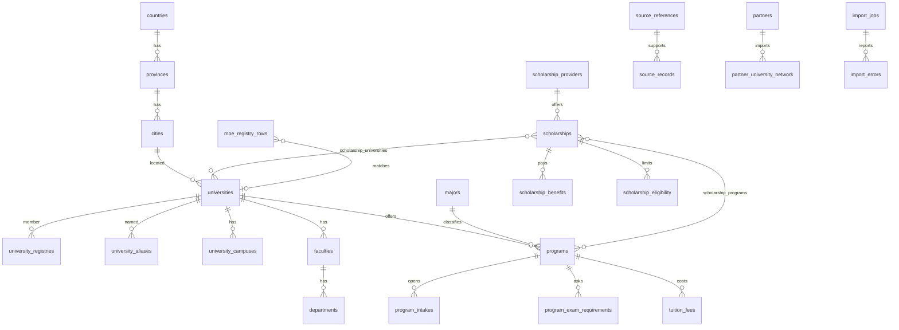

# China Education Knowledge Base

This is the database for Chinese institutions, programs, scholarships, examinations, and fees. It is not connected to Supabase. The website still reads the in-memory catalog.

Apply in this order, later, on an empty Supabase database:

1. `supabase/schema.sql`
2. `supabase/knowledge-base.sql`
3. `supabase/rls.sql`
4. `supabase/rls-knowledge-base.sql`
5. `supabase/seeds/demonstration.sql` only in a non-production database

`supabase/seeds/demonstration.sql` inserts one draft row whose English name is `DEMONSTRATION ONLY — not a university`, plus five headline counts. It does not insert a real institution, a program, a fee, or an admission rule.

## What already existed

`supabase/schema.sql` already had countries, provinces, cities, universities, campuses, contacts, faculties, disciplines, programs, scholarships, examinations, document types, translations, applications, partners, and audit logs. Those tables stay. The knowledge-base file adds columns and tables. It does not drop the tutoring product, because tutoring is not in this database.

## Three registries, one university row

A university is one row. Membership is `university_registries.registry`:

| Registry | Meaning |
| --- | --- |
| `moe_national` | On the Ministry of Education institution list |
| `international_admission` | A source says it accepts international students |
| `dongxueji_partner` | In the DongXueJi network |

The same university can be in more than one registry. A Ministry listing does not set `international_student_status`. That column stays `unknown` until a source says `accepts` or `does_not_accept`.

The June 2026 headline counts from the project brief are stored as `registry_statistics`, not as 3,196 invented schools:

| Metric | Value |
| --- | --- |
| Higher education institutions | 3,196 |
| Regular higher education institutions | 2,952 |
| Undergraduate institutions | 1,412 |
| Higher vocational institutions | 1,540 |
| Adult higher education institutions | 244 |

Those five rows are `pending_verification`. The institution file and its exact notice URL are not in this repository, so they are not marked officially verified. 2,952 + 244 = 3,196. The undergraduate and vocational counts are a split of the regular institutions, not an extra set of schools.

## Names and languages

`universities.name_zh`, `name_en`, and `name_mn` are the searchable names. `university_aliases` holds official, historical, abbreviated, and transliterated names. Longer text uses the existing `translations` table (`entity_table`, `entity_id`, `field_name`, `locale` of `mn`, `en`, or `zh`). A language does not create a second university.

## Academic catalog

`faculties` → `departments` → `programs`. `disciplines` and `majors` classify a program. One program is one row, with degree, teaching language, study mode, year, and publication status.

Degree values include language, foundation, associate, bachelor, master, phd, doctoral, exchange, short-term, summer, winter, and non-degree. `program_languages`, `program_intakes`, and `program_campuses` are separate. `program_requirements` remains the age, education, and GPA row for a program and year.

The old `programs.annual_tuition_cny` column stays nullable so the first schema still loads. New money goes to the fee tables.

## Scholarships

`scholarship_providers` names CSC, a university, a province, a municipality, or another body. `scholarship_universities` and `scholarship_programs` attach one scholarship to many universities and programs. Categories include CSC Type A, CSC Type B, Belt and Road, Silk Road, the International Chinese Language Teachers scholarship (`confucius` in the existing check), full, partial, and tuition waiver.

`scholarship_benefits` is coverage, stipend, and insurance. `scholarship_eligibility` is age and GPA. They are different tables. `scholarship_documents` lists required document types. Amounts stay null until a source is attached.

## Examinations

`examinations` and `examination_subjects` already exist. `examination_score_scales` stores the scale, not a university’s cut score. `university_exam_requirements` and `program_exam_requirements` store a minimum score for one subject, one year, and one owner. `mandatory` is explicit. An absent CSCA subject is not a requirement. `published_program_exam_rules` exposes only published programs for a future checker. It has no probability column.

## Fees

`tuition_fees`, `accommodation_fees`, `application_fees`, `insurance_fees`, `other_fees`, and `living_cost_estimates` each require an amount, a currency, a period, and a `source_id`. Tuition periods are year, semester, or whole program. Accommodation periods are year, semester, or month. An application fee is `once`. A row cannot record a monthly rent figure in the yearly tuition table.

## Documents

`document_types` is the shared list (passport, diploma, transcript, HSK, study plan, and the rest are codes to insert when a real checklist arrives). `program_document_requirements`, `scholarship_documents`, and `application_checklists` say which type a program, scholarship, degree, and year asks for. Uploaded files stay in `application_documents.storage_path` and are not public catalog rows.

## Sources and verification

`source_references` is the source table. The view `sources` exposes the same rows. Types now include `ministry_of_education` and `dongxueji_partner`. Status values include `officially_verified` and `partner_provided`. Partner-provided is not officially verified.

`source_documents` and `source_records` point at the file and the field it supports. `data_verifications` records who checked a field. `data_change_logs` stores the previous and new text. `audit_logs` remains the action log. `audit_logs.context` is still the only general-purpose JSONB column besides raw import payloads.

## DongXueJi import

Raw rows land in `partner_university_network`, `partner_program_data`, and `partner_scholarship_data` (`raw jsonb`). `moe_registry_rows` holds an official registry file the same way. `import_jobs` and `import_errors` record the run.

`match_university_candidates(code, name_zh, name_en)` only returns existing ids matched on institution code, Chinese name, English name, or alias. It does not update a university. A loader must refuse to overwrite a field whose `verification_status` is `officially_verified`.

`partner_communications` is for private messages. It has no public read policy. Do not put a contract or a private phone number in a published university column. `university_contacts.is_public` defaults to false.

There is no Excel parser in the site. When a file is authorized, load it into the raw tables, review `import_errors`, then promote matched rows by hand or by a later job.

## Publication

`publication_status` is `draft`, `pending_review`, `verified`, `published`, `expired`, or `archived`. Public read policies return a university, program, or scholarship only when the status is `published`. Fees are public only when `verification_status` is `officially_verified`.

The intended pipeline is: load the Ministry file, load the partner file, match, mark international admission only where a source says so, then load programs, scholarships, exams, and fees with source ids, validate, and publish. If a source cannot be fetched, leave the field null and add an `import_errors` row. Do not bypass a login wall or a robots rule.

## Search indexes

Chinese and English university names, and aliases, have trigram indexes. Programs are indexed by university, degree, and publication status. Tuition is indexed by program and academic year. Exam rules are indexed by program and year. Those indexes are what a later filter on city, province, major, language, scholarship, fee, HSK, IELTS, TOEFL, CSCA, GPA, age, and deadline will use. Age and GPA already live on `program_requirements` and `academic_requirements`. Deadlines live on `program_intakes` and `scholarship_deadlines`.

## Roles

`app_has_role` is security definer, so a public select does not need to read `user_roles`. Admin writes are insert, update, and delete policies, not a `for all` policy. A `for all` policy also applies to select and made a public read fail when `user_roles` was not granted.

## ERD

Phase-1 relationships remain in `docs/erd.md`.
