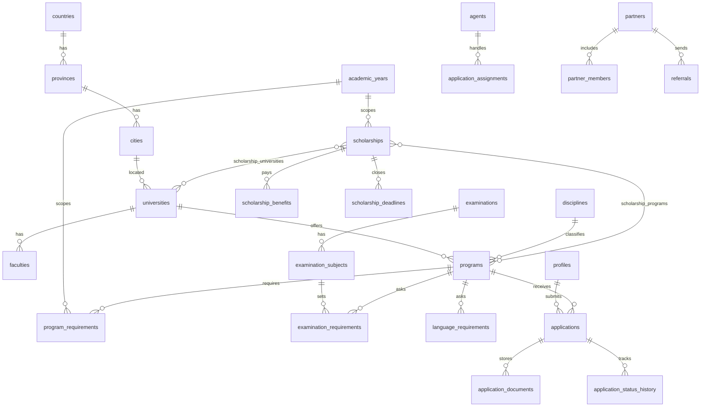

# Өгөгдлийн холбоо

Бүтэн хүснэгт `supabase/schema.sql` дотор. Орчуулга `translations` хүснэгтэд `entity_table + entity_id + field_name + locale`. Одоогийн код орчуулгыг TypeScript объект дээр хадгална. 3-р үед мөр болгоно.

`audit_logs.context` л jsonb. Төлбөр, оноо, баримт бичгийг jsonb-д хийхгүй.
